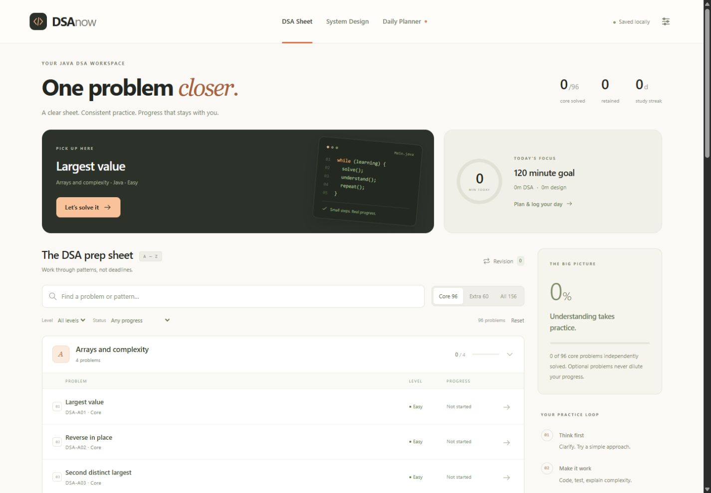

# DSA Now

A focused workspace for **Java DSA, system design and a daily study calendar**.
Three main screens. No career dashboards or fixed 22-week schedule.



## Run locally

Node.js 20 or newer is required. No dependency installation is needed.

```sh
git clone https://github.com/Mandar444/JAVA.git
cd JAVA
npm start
```

Open http://127.0.0.1:48260. On Windows, double-click `Start-DSA.cmd` instead.
Use the same browser and exact address to keep using the same local progress.

## Three screens

- **DSA Sheet:** 156 original Java exercises in 26 topic groups; 96 core and 60 optional. Search, filter, log attempts and revisit problems through the revision queue. Java help is available inside each problem.
- **System Design:** 24 notebooks, starting with requests, APIs, databases and object design. Save notes, sketches, explanations and session time.
- **Daily Planner:** choose a date, assign specific problems/design topics and estimate minutes. Log actual learning time separately. Calendar cells show planned topics and minutes actually learned.

**Plan next 7 days** fills unplanned study days starting from the selected date. It uses the daily goal and study-day count in Settings, prioritizes unsolved core problems and unreviewed design topics, and leaves already planned days alone. When both tracks have available topics, 75% of the daily budget goes to DSA and 25% to design. The default is 120 minutes, six study days.

Marking a plan Done does not add learning time or independently solve a DSA problem. Actual minutes come from saved problem attempts, Java refreshers, design sessions and separate calendar time entries. Only add separate time that has not already been logged with a task. All completion and time are self-reported; the app does not execute or grade Java.

## Progress and backups

Data lives in IndexedDB in your browser profile. Different browsers, ports, domains and `localhost` versus `127.0.0.1` use separate storage. The site does not sync progress between devices.

Export JSON regularly using the footer or Settings. Clearing browser data may erase progress. Version 3 backups include calendar plans and time entries, and imports still accept versions 1 and 2. Older preparation records remain in the activity archive and backups even though their dashboards have been removed.

This repository contains no personal planner data. Import your own backup in Settings to restore progress on a new browser or domain.

## Vercel

`vercel.json` explicitly serves `dist` with no build/install step. Keep the project Root Directory at the repository root. A connected Vercel project redeploys when its production branch is updated.

## Development

```sh
npm test
```

18 tests cover DSA reviews, migration, backup compatibility, conflicts, calendar records and planned-versus-actual time. Use `node server.mjs 48262` for a separate test origin.

- `dist/app.mjs`: application events, forms and existing study workflows.
- `dist/study-ui.mjs`, `dist/studio.css`: three-screen interface and calendar.
- `dist/study-domain.mjs`: calendar records and learning-time calculations.
- `dist/domain.mjs`, `dist/store.mjs`: reviews, backups and IndexedDB persistence.
- `dist/curriculum.js`: exercise and design content.
- `dist/career-domain.mjs`, `dist/career-data.mjs`: compatibility for older preparation backups.
- `server.mjs`: loopback-only local server.
